# Enterprise Azure Virtual Network Security & Segmentation


---

## Project Information

| Item | Details |
|---|---|
| **Project Number** | 07 |
| **Project Title** | Enterprise Azure Virtual Network Security & Segmentation |
| **Business Scenario** | PrimeLink Ltd |
| **Primary Azure Services** | Azure Virtual Network, Subnets, NSGs, Application Security Groups, Network Watcher, Service Endpoints |
| **Security Validation** | Temporary Windows Server 2022 VM |
| **Region** | UK South |
| **Environment** | Enterprise-style portfolio lab |
| **Documentation Standard** | Azure Administrator implementation documentation |

---

# Project Objective

Design and implement a secure and scalable Azure virtual network architecture for PrimeLink Ltd using network segmentation, Network Security Groups (NSGs), Application Security Groups (ASGs), service endpoints, and Azure Network Watcher.

The project demonstrates how an Azure Administrator can design network boundaries, enforce least-privilege traffic controls, troubleshoot connectivity, validate effective security rules and routes, and document the resulting infrastructure.

The implementation also includes a temporary Windows Server 2022 virtual machine used to validate the network security and connectivity configuration. The VM was removed after testing to prevent unnecessary compute charges.

---

# Business Scenario

PrimeLink Ltd is expanding its Azure infrastructure to support internal business applications, file services, administrative resources, and future web-based workloads.

The organization requires a secure and scalable network architecture that separates workloads according to business function and applies appropriate security controls between network segments.

The solution therefore uses an enterprise-style virtual network with dedicated Web, Application, and Database subnets, subnet-level NSGs, application-aware security controls, secure service connectivity, and network diagnostic capabilities.

---

# Business Requirements

The solution was designed to:

- Deploy an enterprise Azure Virtual Network.
- Establish a scalable IP address space.
- Separate workloads into dedicated subnets.
- Apply Network Security Groups to appropriate network boundaries.
- Configure inbound security controls.
- Configure outbound security controls.
- Use Application Security Groups for logical workload grouping.
- Enable secure connectivity to Azure Storage through a Service Endpoint.
- Enable and use Azure Network Watcher.
- Validate network topology.
- Inspect effective security rules.
- Inspect effective routes.
- Test actual network connectivity.
- Demonstrate controlled administrative RDP access.
- Follow least-privilege and defense-in-depth principles.
- Remove temporary compute resources after validation to control cost.

---

# Enterprise Design Principles

The architecture follows these principles:

- **Network segmentation** — isolate workloads by function.
- **Least privilege** — permit only required network traffic.
- **Defense in depth** — apply security controls at appropriate subnet and NIC boundaries.
- **Scalability** — reserve address space for future workload growth.
- **Operational visibility** — use Network Watcher for diagnostics and topology analysis.
- **Secure service access** — use Azure Service Endpoints where appropriate.
- **Cost awareness** — use temporary compute only when required for validation.
- **Standardization** — apply consistent naming and resource organization.

---

# Architecture Overview

The solution is centered on an Azure Virtual Network using the `10.10.0.0/16` address space.

The network is logically segmented into Web, Application, and Database tiers, with dedicated Network Security Groups providing security boundaries.

A temporary Windows Server 2022 virtual machine was deployed during validation to demonstrate practical NSG enforcement, RDP access control, effective security rules, effective routes, and Network Watcher connectivity testing.

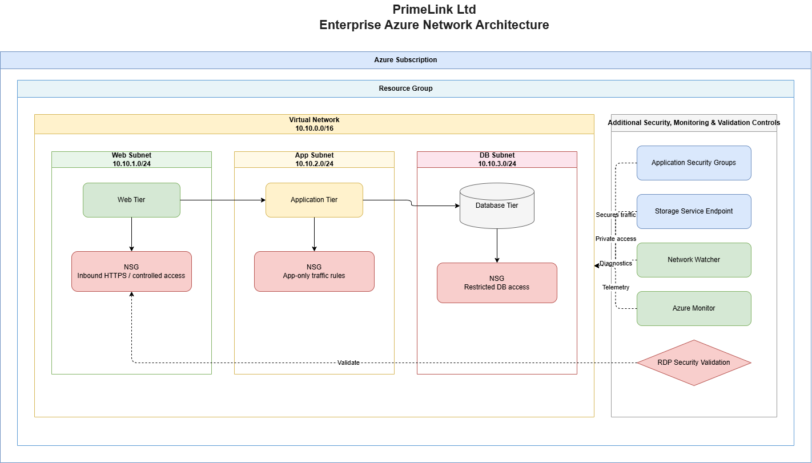

---

# Network Segmentation Strategy

The Virtual Network separates workloads into logical tiers:

| Tier | Purpose | Security Approach |
|---|---|---|
| **Web** | Internet-facing or web workloads | Dedicated subnet NSG |
| **Application** | Application/business logic workloads | Dedicated subnet NSG and application-aware controls |
| **Database** | Data services and database workloads | Dedicated subnet NSG with restricted access |
| **Default** | Existing/default network segment | Retained for existing configuration and administration |

This separation reduces unnecessary lateral communication and makes security policies easier to manage as the environment grows.

---

# Address Space Strategy

The Virtual Network uses:

**`10.10.0.0/16`**

A `/16` address space provides substantially more room for future subnet expansion than a small `/24` network.

The design reserves capacity for future management, production, DMZ, private endpoint, testing, and other enterprise network requirements without requiring an immediate redesign of the Virtual Network address space.

Exact subnet planning and configuration were reviewed during implementation and are supported by the project evidence screenshots.

---

# Network Security Groups

Network Security Groups provide the primary Layer 4 network access control mechanism in this implementation.

NSGs were used at subnet level for workload segmentation and at the network-interface level for the temporary validation VM where appropriate.

The design follows a deny-by-default mindset: required traffic should be explicitly permitted while unnecessary inbound exposure remains blocked.

---

## Inbound Security Controls

Inbound rules were reviewed and configured to control access to workloads.

The implementation demonstrated:

- Rule priority management.
- Source filtering.
- Destination port control.
- TCP protocol filtering.
- Allow/Deny actions.
- Azure default security rules.
- Least-privilege administrative access.

RDP/TCP 3389 was specifically used as a practical administrative-access example during VM validation.

---

## Outbound Security Controls

Outbound NSG rules were reviewed to understand and control traffic leaving protected network resources.

The implementation verified Azure's default outbound behavior and demonstrated how explicit NSG rules can be used when an organization requires tighter egress control.

---

# Application Security Groups

Application Security Groups (ASGs) were created to provide logical grouping of application workloads.

Instead of relying entirely on individual IP addresses, ASGs allow security rules to describe workloads according to their application role.

This approach improves:

- Security rule readability.
- Scalability.
- Workload grouping.
- Future application expansion.
- NSG policy management.

---

# Azure Storage Service Endpoint

A Microsoft.Storage Service Endpoint was enabled on the relevant subnet.

The purpose was to provide optimized connectivity from the Virtual Network to Azure Storage while keeping the design aligned with Azure network security practices.

The configuration was subsequently validated through the Azure Portal.

---

# Azure Network Watcher

Azure Network Watcher was enabled and reviewed in the UK South region.

Network Watcher was used during the project to provide:

- Network topology visualization.
- Connectivity diagnostics.
- Effective security-rule inspection.
- Effective-route inspection.
- Network troubleshooting capabilities.

This demonstrates the operational side of Azure networking rather than focusing only on resource deployment.

---

# Network Topology Validation

Azure Network Watcher topology was used to inspect the logical relationships between the Virtual Network and associated network resources.

The topology view provides an administrator with a visual representation of network dependencies and helps identify whether resources are connected as expected.

---

# Temporary VM Security Validation

To validate the network architecture using a real workload, a temporary Windows Server 2022 virtual machine named:

**`primelink-vm`**

was deployed in UK South.

The VM used:

- Windows Server 2022
- Standard D2s v3
- 2 vCPUs
- 8 GiB RAM
- Private IP address in the VNet
- Network interface: `primelink-vmVMNic`
- NIC-level Network Security Group

The VM was not intended to become a permanent production workload. It was created specifically to provide a realistic endpoint for network-security validation.

After completing the required tests, the VM was deleted to avoid unnecessary compute charges.

> **Security note:** Public IP addresses and administrative credentials are intentionally not published in this portfolio. Any screenshots committed to a public repository should have sensitive or environment-specific values redacted where appropriate.

---

# RDP Security Validation

The temporary VM was used to demonstrate administrative RDP security.

The validation was performed in two stages:

### Stage 1 — Initial RDP Connectivity

TCP port **3389** was initially permitted to demonstrate successful remote administrative connectivity.

A Remote Desktop connection to the VM was successfully established.

### Stage 2 — Restrict RDP Source

The RDP rule was subsequently restricted to a trusted source IP using a `/32` source prefix.

This changed the security model from broad internet exposure to:

```text
Trusted Source IP (/32)
        │
        │ TCP 3389
        ▼
VM Network Security Group
        │
        ▼
VM Network Interface
        │
        ▼
primelink-vm
```

This exercise demonstrates why administrative ports should not remain broadly exposed to the internet.

---

# Effective Security Rules

Azure Network Watcher was used to inspect the effective security rules applied to:

**`primelink-vmVMNic`**

The effective rules view demonstrated:

- The associated NIC-level NSG.
- The restricted RDP rule.
- Azure default virtual-network rules.
- Azure load-balancer rules.
- Default deny behavior.
- Effective inbound and outbound security policy.

This provides stronger evidence than simply showing an NSG configuration page because effective rules demonstrate the policy actually applied to the network interface.

---

# Effective Routes

The VM network interface was also inspected using Azure's **Effective Routes** capability.

The resulting table showed active system routes, including:

- `10.10.0.0/16` → Virtual network
- `0.0.0.0/0` → Internet
- Azure-reserved/private address ranges with no applicable next hop

No custom route table was associated with the NIC during this validation.

This confirms how Azure calculated the effective routing behavior for the VM.

---

# Network Watcher Connectivity Test

The temporary VM was used as the source of an Azure Network Watcher connectivity test to:

**`www.microsoft.com`**

The test used outbound connectivity to validate that the VM could reach an external HTTPS destination.

The completed test reported:

- Source: `primelink-vm`
- Destination: `www.microsoft.com`
- Connectivity: **Reachable**
- Probes sent: **316**
- Probes failed: **0**

This demonstrates successful outbound connectivity and provides practical evidence that the network configuration was operational.

---

# Validation Summary

| Validation Area | Result |
|---|---|
| Virtual Network | ✅ Implemented |
| Network segmentation | ✅ Implemented |
| Web/Application/Database subnets | ✅ Implemented |
| Subnet-level NSGs | ✅ Implemented |
| Inbound security rules | ✅ Validated |
| Outbound security rules | ✅ Validated |
| Application Security Groups | ✅ Implemented |
| Storage Service Endpoint | ✅ Validated |
| Network Watcher | ✅ Validated |
| Network topology | ✅ Validated |
| RDP administrative access | ✅ Tested |
| RDP source restriction | ✅ Tested |
| Effective security rules | ✅ Validated |
| Effective routes | ✅ Validated |
| Outbound HTTPS connectivity | ✅ Reachable |
| Temporary VM cleanup | ✅ Completed |

---

# Administrator Decision Matrix

| Decision | Implementation | Business Justification |
|---|---|---|
| VNet Address Space | `10.10.0.0/16` | Provides long-term expansion capacity |
| Workload Segmentation | Web / Application / Database | Reduces lateral movement and simplifies policy enforcement |
| Security Boundary | NSGs | Provides granular network traffic control |
| Workload Grouping | ASGs | Simplifies application-oriented security rules |
| Storage Connectivity | Microsoft.Storage Service Endpoint | Provides controlled VNet-to-Storage connectivity |
| Network Diagnostics | Network Watcher | Improves operational visibility and troubleshooting |
| Administrative Access | Restricted RDP source | Reduces exposure of TCP 3389 |
| Temporary Compute | Validation VM | Provides realistic testing without becoming permanent infrastructure |
| Cost Control | VM deleted after testing | Prevents unnecessary ongoing compute charges |

---

# Security Considerations

The implementation follows defense-in-depth principles:

- Separate workloads by subnet.
- Apply NSGs at appropriate network boundaries.
- Restrict administrative access.
- Avoid unnecessary public exposure.
- Use application-aware security grouping.
- Validate effective security policy rather than relying only on configuration.
- Validate actual network connectivity.
- Protect sensitive credentials and IP information from public documentation.
- Remove temporary resources when they are no longer required.

---

# Governance Considerations

The network design supports enterprise governance through:

- Standardized resource naming.
- Dedicated production resource organization.
- Logical workload segmentation.
- Least-privilege access principles.
- Documented administrator decisions.
- Operational monitoring and diagnostics.
- Cost-aware resource lifecycle management.
- Future readiness for centralized security controls.

---

# Cost Management

The temporary VM was deliberately used only for practical network validation.

Once the required tests were completed, the VM was deleted to stop ongoing compute charges.

This demonstrates an important Azure Administrator operational practice:

> **Use compute resources when they provide operational value, and remove temporary resources when their purpose has been completed.**

Future production environments should use Azure Cost Management budgets, alerts, tagging, and appropriate VM sizing to maintain cost visibility and control.

---

# Production Readiness Assessment

| Area | Status | Assessment |
|---|---|---|
| VNet Address Planning | ✅ | Scalable `/16` address space |
| Network Segmentation | ✅ | Web/Application/Database separation |
| NSG Protection | ✅ | Subnet and NIC security demonstrated |
| ASG Strategy | ✅ | Logical workload grouping |
| Service Endpoint | ✅ | Storage connectivity validated |
| Network Diagnostics | ✅ | Network Watcher configured |
| Connectivity Testing | ✅ | Actual VM connectivity tested |
| RDP Protection | ✅ | Source restriction demonstrated |
| Effective Security Rules | ✅ | Validated on VM NIC |
| Effective Routes | ✅ | Validated on VM NIC |
| Temporary Resource Cleanup | ✅ | VM deleted after testing |
| Centralized Firewall | Future | Azure Firewall can provide centralized inspection |
| Private Access | Future | Private Endpoints can reduce public exposure |
| Secure VM Administration | Future | Azure Bastion can eliminate public RDP exposure |
| Centralized Logging | Future | Log Analytics/Azure Monitor integration |
| Advanced Threat Protection | Future | Microsoft Defender for Cloud/Storage |
| Infrastructure as Code | Future | Bicep or Terraform automation |

---

# Future Enhancements

### Azure Firewall

Deploy Azure Firewall to provide centralized network traffic inspection, application rules, and threat-intelligence-based protection.

### Azure Bastion

Provide browser-based RDP/SSH access to Azure VMs without exposing management ports directly to the public internet.

### Azure Private Endpoints

Use private connectivity for supported Azure PaaS services to reduce dependence on public endpoints.

### User-Defined Routes

Introduce custom routes where centralized inspection or controlled traffic paths are required.

### DDoS Protection

Apply appropriate Azure DDoS protection to internet-facing production architectures.

### Centralized Monitoring

Integrate Azure Monitor, Log Analytics, alerts, and diagnostic settings for centralized operational visibility.

### Infrastructure as Code

Automate network deployment using Azure Bicep or Terraform for repeatability, consistency, and version-controlled infrastructure.

---

# Implementation Evidence

The following evidence demonstrates the deployment, configuration, security, troubleshooting, and validation stages of the project.

## Phase 1 — Network Architecture & Segmentation

### 01 — Subnet Address Planning

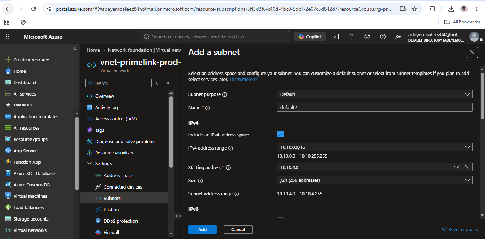

**Planned** the enterprise VNet address space and subnet allocation strategy to support scalable network segmentation and future workload expansion.

---

### 02 — Subnet Security Options

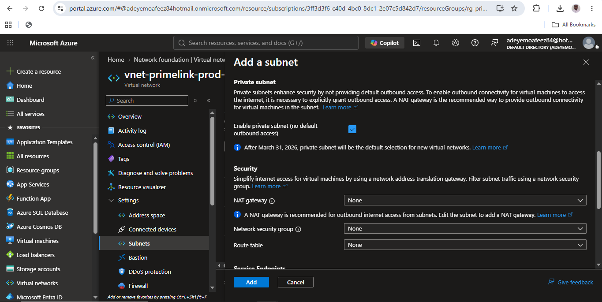

**Reviewed** subnet security capabilities including Network Security Groups, NAT Gateway, route tables, private subnet capabilities, and related configuration options.

---

### 03 — Enterprise Subnet Services

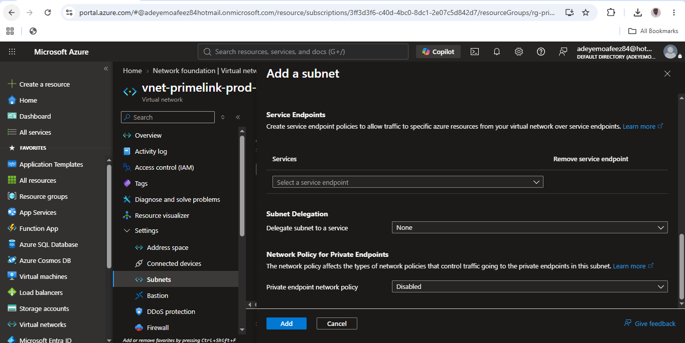

**Evaluated** subnet-level service capabilities including Service Endpoints, subnet delegation, and Private Endpoint network policies.

---

### 04 — Three-Tier Network Segmentation

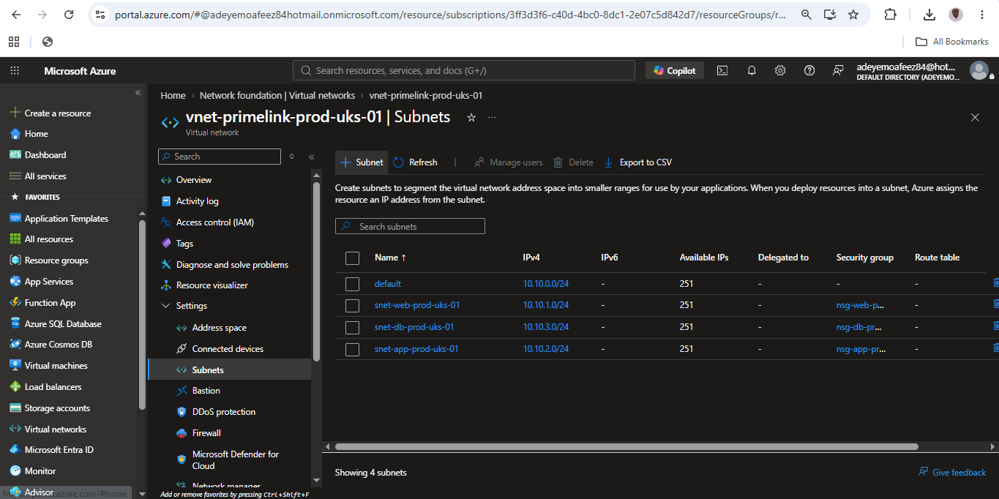

**Implemented** logical Web, Application, and Database network segmentation to establish clear workload security boundaries.

---

### 05 — Network Security Group Overview

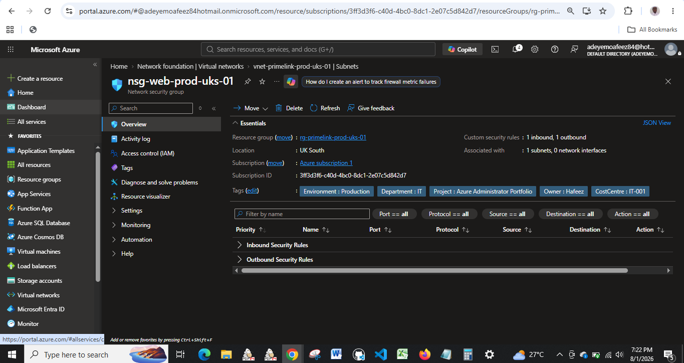

**Reviewed** the Network Security Group configuration protecting the network segment and verified the available security-policy structure.

---

## Phase 2 — Network Security Controls

### 06 — Inbound Security Rules

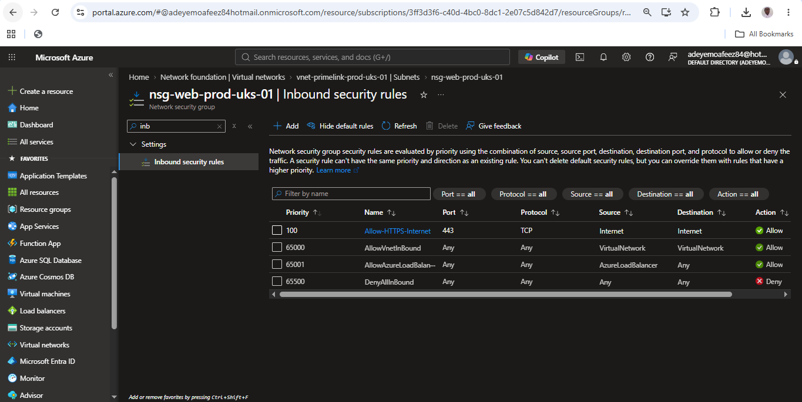

**Validated** inbound NSG rules to ensure required traffic was explicitly controlled while unnecessary inbound traffic remained restricted.

---

### 07 — Application Security Groups

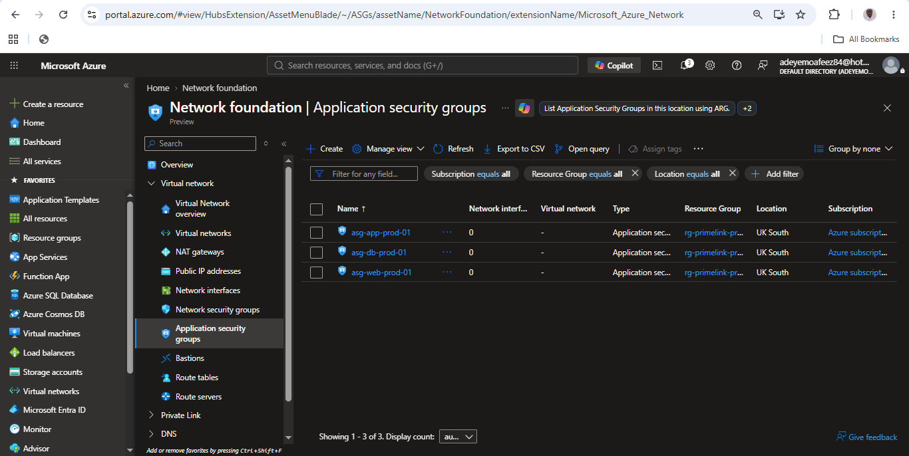

**Created** Application Security Groups to support logical application-based security policies and scalable workload management.

---

### 08 — Outbound Security Rules

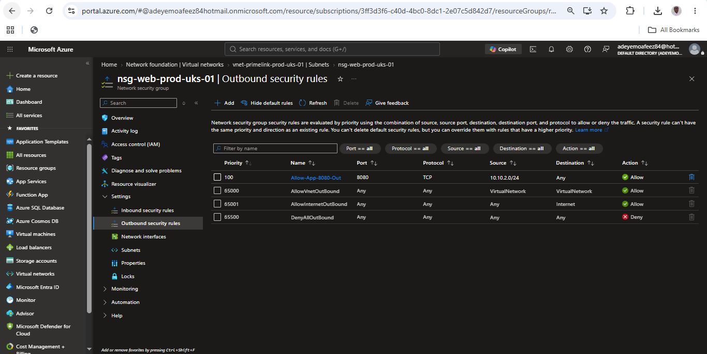

**Reviewed** outbound NSG controls and Azure's default outbound behavior to understand and validate egress traffic handling.

---

### 09 — Storage Service Endpoint

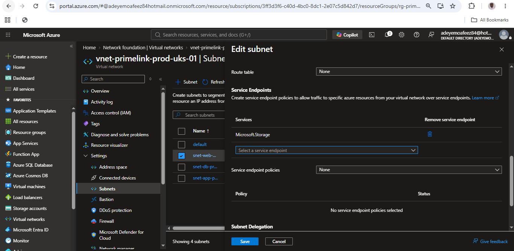

**Enabled** the Microsoft.Storage Service Endpoint to provide controlled connectivity between the VNet and Azure Storage.

---

## Phase 3 — Network Monitoring & Visibility

### 10 — Network Watcher Overview

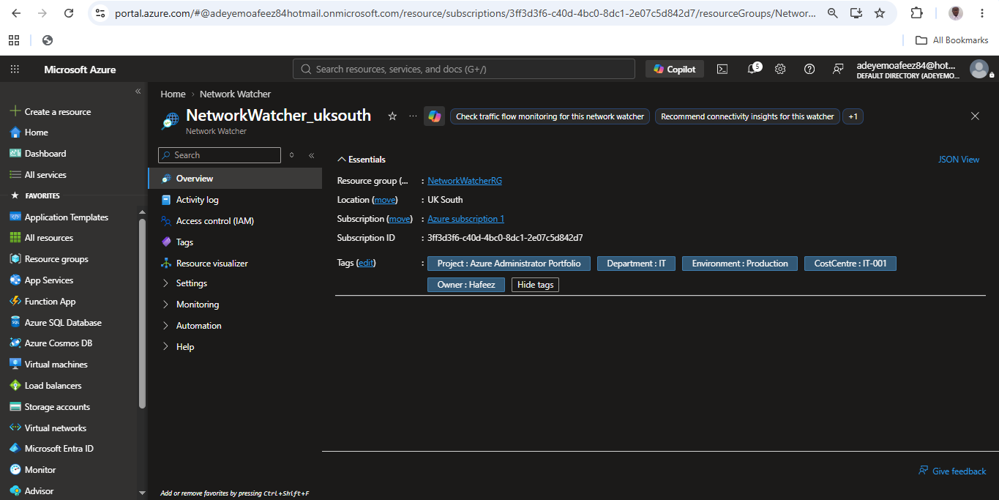

**Verified** Azure Network Watcher availability in UK South to support topology analysis, connectivity diagnostics, and network troubleshooting.

---

### 11 — Network Topology

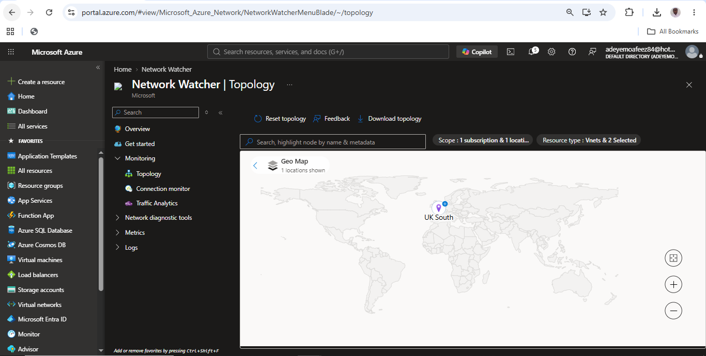

**Generated** the Azure network topology view to validate logical relationships between the Virtual Network and associated network resources.

---

## Phase 4 — VM Security & Connectivity Validation

### 12 — RDP TCP 3389 Initially Allowed

-allowed-from-any-source.png)

**Tested** administrative RDP connectivity over TCP 3389 using the temporary Windows Server VM to establish a practical baseline for network-security validation.

---

### 13 — RDP Restricted to Trusted Source


**Restricted** RDP access from broad source exposure to a trusted `/32` source IP, demonstrating least-privilege administrative access.

> The source IP is intentionally redacted or omitted from public documentation.

---

### 14 — RDP Connection Successful

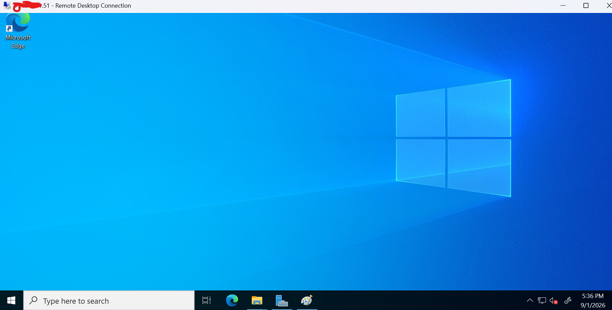

**Confirmed** successful Remote Desktop connectivity from the trusted source to the temporary Windows Server VM after the RDP source restriction was applied.

---

### 15 — Effective Security Rules

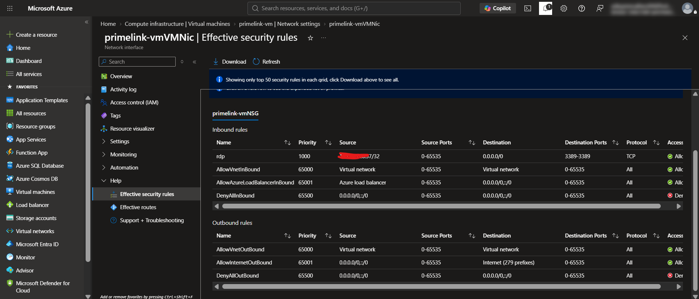

**Validated** the effective inbound and outbound security rules applied to `primelink-vmVMNic`, confirming the actual policy enforced by the associated NSG.

---

### 16 — Effective Routes

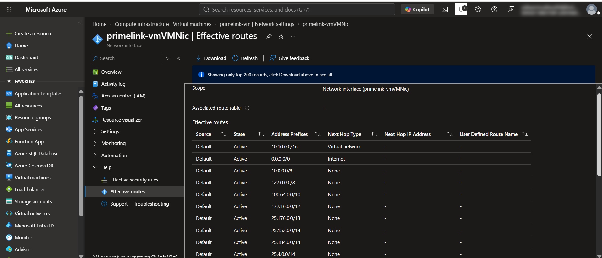

**Reviewed** the effective routing table applied to the VM network interface, including the VNet route, internet route, and Azure system routes.

---

### 17 — Network Watcher HTTPS Connectivity Test

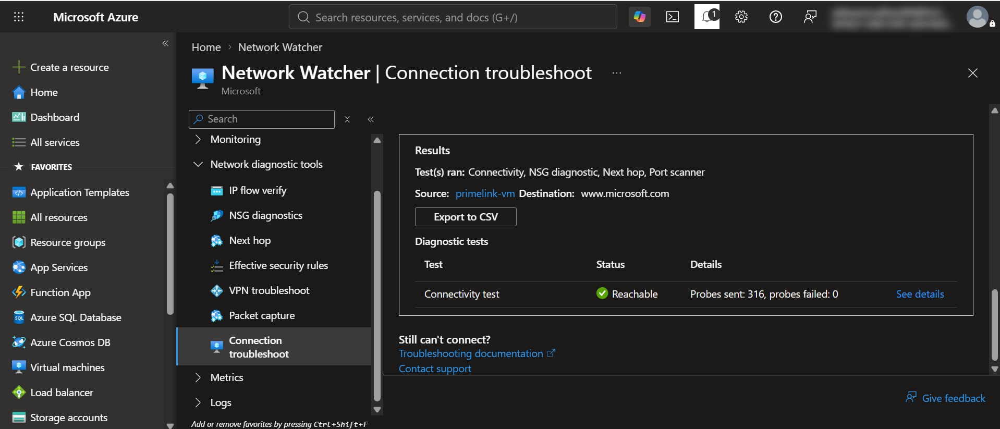

**Validated** outbound connectivity from `primelink-vm` to `www.microsoft.com`, with Azure reporting the destination as reachable and zero failed probes.

---

# Implementation Approach

The project was implemented primarily through the Azure Portal for visual configuration and evidence capture.

Azure CLI was also used for selected administrative tasks, including deployment of the temporary validation VM.

The combination of Portal-based configuration and CLI-based administration demonstrates both graphical Azure management and command-line operational capability while keeping the portfolio evidence easy to understand.

Sensitive credentials are intentionally excluded from the documentation.

---

# Key Administrator Lessons

This project demonstrated several practical Azure Administrator skills:

1. **Network segmentation should be planned before workload deployment.**
2. **NSGs should enforce only the traffic that is actually required.**
3. **Administrative ports such as RDP should never be unnecessarily exposed.**
4. **Effective security rules are more valuable for troubleshooting than simply viewing configured rules.**
5. **Effective routes help explain actual traffic paths through Azure networking.**
6. **Network Watcher provides practical tools for diagnosing connectivity problems.**
7. **Application Security Groups improve the readability and scalability of security policies.**
8. **Service Endpoints can provide controlled access to supported Azure services.**
9. **Temporary compute resources should be removed after testing to control cost.**
10. **Network security should be validated with real connectivity tests, not only configuration screenshots.**

---

# Project Conclusion

Project 07 demonstrates the design and administration of an enterprise-style Azure Virtual Network with workload segmentation, Network Security Groups, Application Security Groups, Service Endpoints, and Network Watcher diagnostics.

The project goes beyond basic resource creation by validating the resulting network behavior through a temporary Windows Server workload. RDP access was tested and subsequently restricted to a trusted source, effective security rules and routes were inspected, and outbound connectivity was successfully validated using Network Watcher.

The temporary VM was removed after validation, demonstrating cost-conscious Azure administration.

The architecture provides a strong foundation for future production enhancements including Azure Firewall, Azure Bastion, Private Endpoints, centralized monitoring, advanced threat protection, and Infrastructure as Code.

---

# Project Status

**Status: Completed — Network Security & Connectivity Validated**

The implementation satisfies the core objectives of Project 07 and provides documented evidence of Azure network design, security configuration, troubleshooting, connectivity validation, and administrator decision-making.
