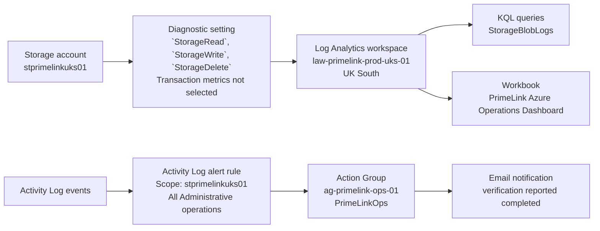
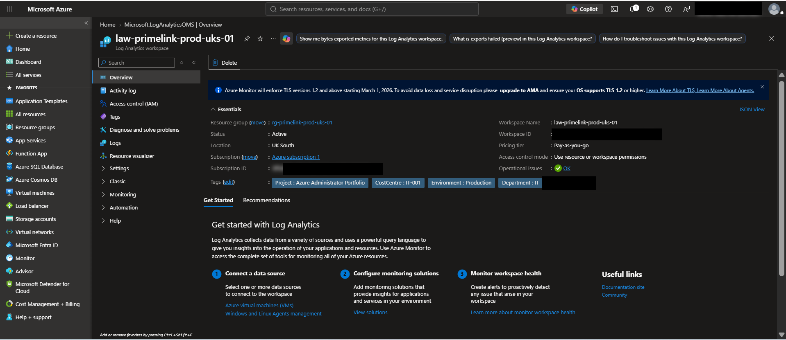
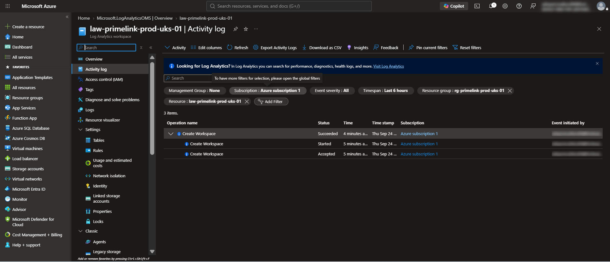
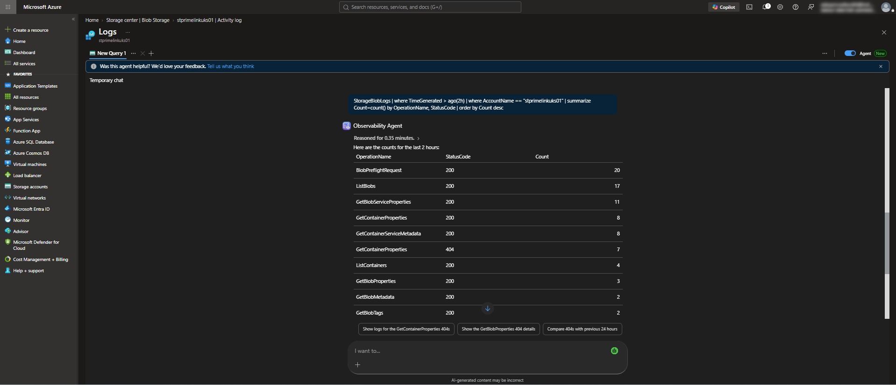
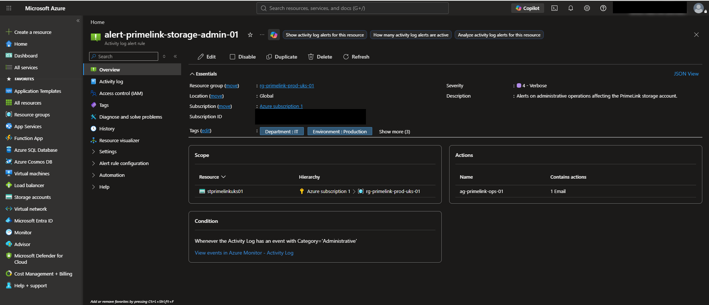
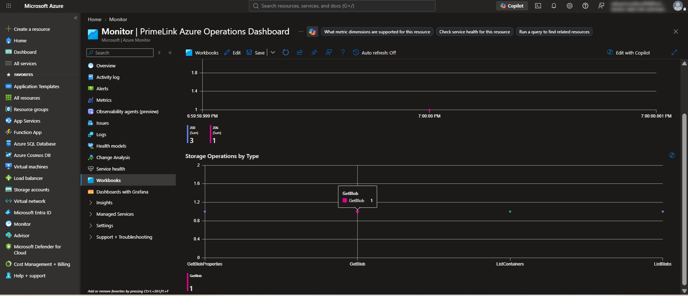
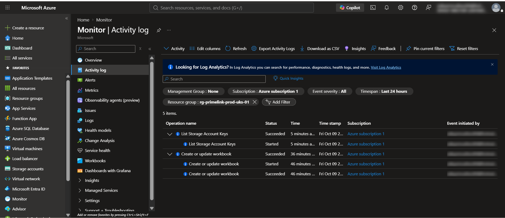

# Enterprise Azure Monitoring and Operations


---

## Project Information

| Item | Details |
|---|---|
| **Project Number** | 08 |
| **Project Title** | Enterprise Azure Monitoring and Operations |
| **Business Scenario** | PrimeLink Ltd |
| **Primary Azure Services** | Azure Monitor, Log Analytics workspace, Storage account diagnostic settings, Activity Log alerts, Action Groups, Workbooks |
| **Monitored Resource** | `stprimelinkuks01` |
| **Primary Region** | UK South |
| **Environment** | Enterprise-style portfolio lab |
| **Documentation Standard** | Azure Administrator implementation documentation |

---

## Project Objective

Configure an operational monitoring foundation for the PrimeLink Azure Storage account using Azure Monitor and Log Analytics. The implementation centralizes selected Storage resource logs, validates Blob operations with Kusto Query Language (KQL), provides a workbook view, and configures an Activity Log alert with an email Action Group.

This project documents the resources and checks completed in the lab. It does not represent a complete production monitoring service or VM monitoring deployment.

---

## Business Scenario

PrimeLink Ltd needs operational visibility into Azure Storage activity and a way to review administrative events affecting its storage account. The Azure Administrator configures diagnostic logging to a Log Analytics workspace, validates actual Blob Storage operations, and creates an Activity Log alert and an operations workbook.

The monitoring scope for this implementation is the storage account and its available Azure control-plane activity. No virtual machine was deployed as part of Project 08.

---

## Business Requirements

The implementation was intended to:

- Centralize selected Storage resource logs in Log Analytics.
- Validate real Blob Storage requests and their HTTP status codes.
- Use KQL to inspect Storage operations and summarize request counts.
- Provide a workbook for reviewing storage requests and operation types.
- Create an Activity Log alert for administrative operations on the storage account.
- Route the alert rule to a configured email Action Group.
- Record validation outcomes and known limitations accurately.

---

## Architecture Overview

The Storage account sends selected resource logs to the Log Analytics workspace through a diagnostic setting. KQL queries and the workbook use that workspace data. Separately, the Activity Log alert rule monitors administrative operations on the storage account and is associated with an Action Group containing an email notification.



The Log Analytics workspace and Storage account are in UK South. The Action Group was configured in East US. Email verification was reported as completed during the lab, but no verification-status screenshot or record is included in this repository. Alert firing and email delivery were not tested.

---

## Enterprise Design Principles

- **Centralized operational data** — send selected Storage resource logs to a Log Analytics workspace for KQL analysis.
- **Evidence-based validation** — use actual Blob operations and their returned HTTP status codes as implementation evidence.
- **Scoped monitoring** — scope the Activity Log alert rule to the specified storage account.
- **Actionable visualization** — use a workbook to summarize storage requests by hour and status code, and by operation type.
- **Accurate alert expectations** — distinguish a created alert rule and reported email verification from a fired alert or delivered email.
- **Cost awareness** — use the Pay-as-you-go workspace plan and avoid deploying a VM when guest-level monitoring is outside this project's scope.

---

## Implementation Details

### Log Analytics Workspace

The workspace `law-primelink-prod-uks-01` was created in resource group `rg-primelink-prod-uks-01`, in UK South, using the Pay-as-you-go pricing plan. It is the destination for the Storage account diagnostic logs and the data source for KQL queries and the workbook.

### Storage Diagnostic Setting

The Storage account `stprimelinkuks01` uses diagnostic setting `diag-stprimelink-storage-uks-01` to send the `StorageRead`, `StorageWrite`, and `StorageDelete` log categories to the existing Log Analytics workspace. Transaction metrics export was not selected.

### Blob Storage Operations

Real Blob Storage requests were performed to validate that the resource logs captured storage operations. The lab record lists these HTTP status results:

| Blob operation | HTTP status |
|---|---:|
| `CreateContainer` | 201 |
| `PutBlob` | 201 |
| `GetBlob` | 200 |
| `DeleteBlob` | 202 |

These values are recorded lab results. The published broad two-hour screenshot does not independently display these individual operation/status pairs.

The temporary test blob was deleted after validation. The private `monitoring-test` container remains in the Storage account.

### Activity Log Alert and Action Group

Action Group `ag-primelink-ops-01` was configured in East US with display name `PrimeLinkOps`. One email notification was configured. Email verification was reported as completed during the lab, but no verification-status screenshot or record is included in this repository. The alert overview shows one configured email action; it does not show address verification. Alert firing and email delivery were not tested.

Activity Log alert rule `alert-primelink-storage-admin-01` was created with scope `stprimelinkuks01`, condition **All Administrative operations**, and Action Group `ag-primelink-ops-01`. The rule's creation and overview were verified. The broad administrative-operations condition is appropriate for this lab exercise; production monitoring should narrow the condition to the specific operations and impact that require notification.

### Operations Workbook

Workbook **PrimeLink Azure Operations Dashboard** was saved in UK South. It contains two visualizations:

1. Storage requests by hour and status code.
2. Storage operations by type.

### Activity Log Operational Check

Activity Log validation was performed for the storage account. The initial resource-filtered query returned zero results; a later check showed storage-account activity. This confirms that activity was observed in the later check, but does not establish that every expected event appeared in the initial query or that the alert fired.

---

## Security Considerations

- Diagnostic logs are sent to the named Log Analytics workspace for operational review.
- The `monitoring-test` container is private.
- The temporary test blob was removed after the Storage operation checks.
- The Action Group email address is not published in this documentation.
- Email address verification, when completed, confirms notification address configuration; it does not prove alert email delivery. Verification was reported as completed, but no verification-status screenshot or record is included here.
- The Activity Log alert condition is intentionally broad for the lab. Narrow it to relevant administrative operations before adopting a similar rule in production.
- No passwords, tokens, subscription IDs, or personal credentials are included.

---

## Governance Considerations

- The workspace and Storage account use the portfolio's existing production-style resource group and naming conventions.
- The diagnostic setting explicitly selects the `StorageRead`, `StorageWrite`, and `StorageDelete` log categories.
- The Activity Log alert is scoped to the Storage account and associated with a named Action Group.
- The workbook provides a repeatable view of selected storage request activity.
- Production deployments should review diagnostic category selection, data retention, alert scope, alert criteria, ownership, and operational response procedures.

---

## Cost Management

The Log Analytics workspace uses the Pay-as-you-go plan. No measured ingestion volume, billing amount, or quantified cost saving is documented by this implementation, so no cost total or saving is claimed here.

No VM was deployed for Project 08. Temporary VMs used in earlier portfolio work were removed to control ongoing compute cost. As a result, this project does not demonstrate VM Insights, guest-level CPU or memory monitoring, or VM metric alerts.

For production use, monitor workspace ingestion and retention against the selected pricing plan and review the cost impact of enabled diagnostic categories. Configure budgets and alerts based on actual subscription cost data.

---

## KQL Queries

The following queries inspect records for `stprimelinkuks01` in the `StorageBlobLogs` table. The first query lists the validated operations and status codes. The second summarizes request counts by operation and HTTP status. The final two queries match the workbook visualizations. Counts returned depend on the data and time range available in the workspace when the query is run.

These queries do not include an explicit `TimeGenerated` predicate. In Azure Monitor Logs, the time picker constrains query results; record the selected time range when comparing results. The repository does not include the workbook definition, so its query-step time-range configuration cannot be independently confirmed.

### Inspect Blob Operations and Status Codes

```kusto
StorageBlobLogs
| where AccountName == "stprimelinkuks01"
| where OperationName in ("CreateContainer", "PutBlob", "GetBlob", "DeleteBlob")
| project TimeGenerated, OperationName, StatusCode
| order by TimeGenerated asc
```

### Count Operations by Type and Status Code

```kusto
StorageBlobLogs
| where AccountName == "stprimelinkuks01"
| summarize RequestCount = count() by OperationName, StatusCode
| order by OperationName asc, StatusCode asc
```

### Workbook: Storage Requests by Hour and Status Code

```kusto
StorageBlobLogs
| where AccountName == "stprimelinkuks01"
| summarize RequestCount = count() by bin(TimeGenerated, 1h), StatusCode
| order by TimeGenerated asc
```

### Workbook: Storage Operations by Type

```kusto
StorageBlobLogs
| where AccountName == "stprimelinkuks01"
| summarize RequestCount = count() by OperationName
| order by RequestCount desc
```

---

## Validation Summary

| Validation area | Result |
|---|---|
| Log Analytics workspace | Created in UK South with Pay-as-you-go plan |
| Storage diagnostic setting | `StorageRead`, `StorageWrite`, and `StorageDelete` logs routed to the workspace; transaction metrics not selected |
| Blob container and object operations | Lab record lists `CreateContainer` 201, `PutBlob` 201, `GetBlob` 200, and `DeleteBlob` 202; the published screenshot does not independently show these pairs |
| Test data cleanup | Temporary test blob deleted; private `monitoring-test` container remains |
| KQL | `StorageBlobLogs` queried for operation records, operation counts, and HTTP status codes |
| Action Group | Created in East US; one email action shown in the alert overview; verification was reported but is not evidenced in this repository |
| Alert rule | Created and overview verified; alert firing and email delivery were not tested |
| Operations workbook | Saved in UK South with two storage visualizations |
| Activity Log | Initial resource-filtered query returned zero results; a later check showed storage-account activity |
| VM monitoring | Not implemented; no VM was deployed for Project 08 |

---

## Implementation Evidence

The following existing screenshots document the workspace, storage log validation, alert configuration, workbook, and Activity Log checks.

### 01 — Log Analytics Workspace



### 02 — Activity Log Workspace Creation



### 03 — Storage Blob Operations Log Validation



The broad query shown in this screenshot covers the previous two hours and includes seven `GetContainerProperties` records with HTTP status 404. The available evidence does not show request details or establish why those responses occurred; their cause was not determined.

### 04 — Alert Rule Overview



### 05 — Azure Monitor Operations Workbook



### 06 — Activity Log Operational Validation



---

## Production Readiness

| Area | Status | Assessment |
|---|---|---|
| Storage resource logs | Implemented | Selected `StorageRead`, `StorageWrite`, and `StorageDelete` logs route to Log Analytics |
| Blob operation results | Recorded | The README records the four status codes; the published screenshot does not independently show those individual operation/status pairs |
| KQL review | Validated | Storage operation records and counts were queried from `StorageBlobLogs` |
| Workbook | Implemented | Two storage request visualizations are saved in UK South |
| Activity Log alert rule | Configured | Rule created and overview verified; firing was not tested |
| Email notification | Configured | One email action is shown in the alert overview; verification was reported but is not evidenced here; delivery was not tested |
| Activity Log query | Partially validated | Initial resource-filtered query returned no results; later check showed storage-account activity |
| VM guest monitoring | Not implemented | No VM was deployed; no VM Insights or guest-level monitoring is claimed |
| Production alert tuning | Future | Narrow the broad administrative-operation condition to relevant events |
| Cost baseline | Not measured | Review actual ingestion, retention, and billing data before setting cost targets |

---

## Future Enhancements

The following are potential future improvements and were not implemented or validated as part of this project:

- Narrow the Activity Log alert condition to selected administrative operations and define an operational response process.
- Test alert firing and end-to-end email delivery in a controlled environment.
- Review Log Analytics retention and ingestion settings against actual operational and cost requirements.
- Add Azure Monitor metric alerts for appropriate Storage metrics and validate their behavior.
- Consider VM monitoring with Azure Monitor Agent and VM Insights if a VM workload is introduced in a future project.
- Extend the workbook with additional operational views based on validated requirements.
- Automate repeatable deployment using Bicep as the portfolio progresses into Infrastructure as Code.

---

## Key Administrator Lessons

1. **Diagnostic settings define the resource logs and metrics exported**; selecting `StorageRead`, `StorageWrite`, and `StorageDelete` does not automatically export transaction metrics.
2. **Real requests provide useful validation evidence** when their corresponding resource logs can be queried with KQL.
3. **HTTP status codes help distinguish successful operations**, including asynchronous delete acceptance, from failed requests.
4. **A configured alert rule is not proof that the alert fired.** Verify rule scope and condition, then test firing and notification delivery separately where authorized.
5. **Activity Log query scope and filters matter.** A zero-result filtered query should be reported accurately and followed by a carefully scoped operational check.
6. **Workbooks make operational data easier to review**, while their visualizations remain dependent on available workspace data.
7. **Monitoring should match deployed resources.** This project has no VM and therefore makes no claims about guest-level monitoring.
8. **Cost statements require billing or usage data.** A Pay-as-you-go plan alone does not establish the actual project cost.

---

## Project Conclusion

Project 08 establishes a documented Azure monitoring workflow for the PrimeLink Storage account. Selected `StorageRead`, `StorageWrite`, and `StorageDelete` logs are sent to Log Analytics, the lab record lists Blob operation status codes that are not independently displayed in the published screenshot, KQL queries were used to review the resulting data, and a workbook presents storage activity in two visualizations.

An Activity Log alert rule and email Action Group were created and reviewed. Email verification was reported as completed during the lab, but no verification-status screenshot or record is included in this repository. The alert overview shows one configured email action; it does not show address verification. Neither alert firing nor email delivery was tested. Activity Log validation showed storage-account activity in a later check after an initial resource-filtered query returned no results. These limits are reflected in the validation summary.

No VM was deployed for this project. The implementation is a lab monitoring foundation, with alert tuning, delivery testing, cost measurement, and any guest-level monitoring left as future work.

---

## Project Status

**Status: Completed — Storage Monitoring and Operations Lab Validated**

The documented scope covers Storage resource logging, Blob operation checks, KQL review, a two-visualization workbook, and creation and review of an Activity Log alert rule and Action Group. Alert firing, email delivery, VM monitoring, and quantified costs were not validated.
